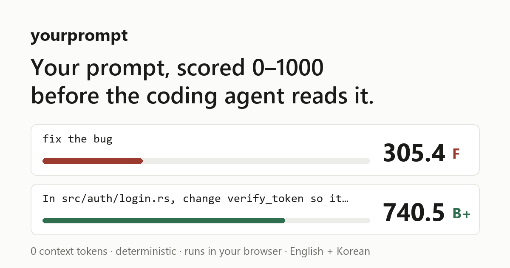

<h1 align="center">yourprompt</h1>

<p align="center">
  A prompt score for Claude Code that costs zero context tokens.<br>
  Grounded in your repository. Deterministic. No model call.
</p>

<p align="center">
  <a href="https://liu-sky.github.io/yourprompt/"><b>Try it in the browser</b></a> ·
  <a href="#install">Install</a> ·
  <a href="#how-the-score-is-built">How the score is built</a> ·
  <a href="#benchmarks">Benchmarks</a>
</p>

<p align="center">
  <a href="https://github.com/LiU-SKY/yourprompt/actions/workflows/ci.yml"></a>
  <a href="https://github.com/LiU-SKY/yourprompt/actions/workflows/pages.yml"></a>
  <a href="LICENSE"></a>
  
  
</p>

```
[Opus] ~/proj main 42% ctx  ⟦ 740.5 ▓▓▓▓▓▓▓░░░ B+ ▲ ⟧
```

<p align="center">
  
</p>

Every prompt you send gets a 0 to 1000 score in the status line, before the
model answers. The score says how well a coding agent can act on the prompt
*in this repository*: whether the things you name exist, whether they point at
one place or forty, and whether you said what done looks like.

- **Zero tokens.** The hook prints nothing. The status line never enters the
  model's context. Your `/context` count is the same with or without it.
- **Grounded.** `yp index` builds a symbol index of your repo. "Fix the login
  handler" scores differently in a repo where `login` is one function and in
  one where it matches 37 places.
- **No model call.** Dictionaries, corpus statistics and a tokenizer. Same
  input, same score, every time. Nothing leaves your machine.
- **Explains itself.** `/score` prints every component with the reason it got
  that number.
- **Shows it in place.** In the web UI the prompt is coloured as you type:
  green where it earned points, yellow where it is unclear, red where it lost
  them, with a chip per word saying why.
- **Grades tasks, not chatter.** Slash commands and short follow-ups like
  "yes", "continue" or "계속해" are not graded, so the status line keeps your
  last task's score instead of flashing an F.
- **English and Korean.** A prompt in another language says "not graded"
  rather than failing.

## Try it

No install: **<https://liu-sky.github.io/yourprompt/>**. The scorer is compiled
to WebAssembly. Drop your own source files on the page and they are indexed
locally, so the grounding axis is about your code. Nothing is uploaded.

With no files loaded, names cannot be checked, and the page says so next to
the grade: a prompt about a made-up `src/banana.rs` scores the same 740.5 as
the real one. Load the six-file sample repo and the real prompt rises to 851.8
while the made-up one falls to 563.8.

Or from the command line, here in a directory with no index:

```console
$ yp score "fix the login handler"
  294.3 / 1000  F  ▓▓▓░░░░░░░

$ yp score "In src/auth/login.rs, change verify_token so it returns Err(AuthError::Expired) instead of panicking on an expired token. Keep the public signature of login(). tests/auth.rs::expired_token_is_rejected must pass."
  735.0 / 1000  B+  ▓▓▓▓▓▓▓░░░

$ yp score "continue"
  not graded: a follow-up like this leans on the conversation
```

## Install

macOS and Linux:

```bash
curl -fsSL https://raw.githubusercontent.com/LiU-SKY/yourprompt/main/install.sh | sh
```

Windows, in PowerShell:

```powershell
irm https://raw.githubusercontent.com/LiU-SKY/yourprompt/main/install.ps1 | iex
```

Each script downloads the build for your machine from the latest release,
checks it against its published SHA-256, and puts `yp` in `~/.local/bin`. On
Windows it goes in `%LOCALAPPDATA%\Programs\yourprompt`, which is added to your
user PATH. No sudo, no administrator. `curl ... | YP_VERSION=v0.1.1 sh` (or
`$env:YP_VERSION` in PowerShell) pins a release, and `YP_INSTALL_DIR` picks the
directory.

The same builds are on the
[Releases page](https://github.com/LiU-SKY/yourprompt/releases): Linux (static,
x86_64 and arm64), macOS (Intel and Apple silicon) and Windows (x64 and arm64),
each with a `.sha256` file that `sha256sum -c` checks.

Or build from source, with Rust 1.85 or newer:

```bash
cargo install --git https://github.com/LiU-SKY/yourprompt yp-cli
```

Then:

```bash
yp install
```

`yp install` registers the `UserPromptSubmit` hook and the status line in your
Claude Code settings. It backs the file up first. If you already have a status
line it wraps yours and appends the score segment.

```bash
yp install --print-only   # show the change, write nothing
yp install --uninstall    # restore the backup
```

There is also a Claude Code plugin under [`plugin/`](plugin/). Plugins cannot
register a status line, so you still run `yp install` for that part.

## How it stays at zero tokens

Claude Code injects a `UserPromptSubmit` hook's stdout into the model's
context. That is why LLM-based prompt improvers cost tokens. Status line output
never reaches the model. So:

```
prompt ─┬─▶ yp hook        stdout: ""   exit 0     nothing injected
        │                  writes ~/.claude/yourprompt/sessions/<id>.json
        └─▶ yp statusline  reads the file, renders the bar
```

The hook never blocks and never indexes. If anything goes wrong it exits 0
silently. Indexing runs from the session-start hook, or by hand with `yp index`.

## How the score is built

Four axes, 1000 points total. Every count goes through a saturating function,
and each axis has a cap, so no single trick can max the score.

| Axis | Points | What it measures |
|---|---:|---|
| **Grounding** | 350 | Do the names in the prompt resolve to exactly one thing in this repo? How specific is the vocabulary to this codebase? Are there pronouns with no antecedent ("it", "that one", "그거")? |
| **Actionability** | 250 | One clear command verb and goal. Explicit inputs and outputs. A stated acceptance criterion ("tests pass", "must return X"). |
| **Clarity** | 250 | Starts full, loses points per ambiguity smell: subjective terms, comparatives with no baseline, hedges, vague adverbs, passive voice, escape clauses, contradictions. |
| **Context** | 150 | Scope limits ("don't touch X"), examples, code blocks, lists, and length in a reasonable range. |

Without an index the grounding axis is off and the other three are
renormalised to 1000. The status line marks this with `~`.

The smell list comes from Femmer et al., *Rapid quality assurance with
Requirements Smells* (JSS 2017), which derives it from ISO/IEC/IEEE 29148.
The specificity measure comes from pre-retrieval query performance prediction
(Hauff et al., CIKM 2008). See [Prior art](#prior-art).

### Grounding, on this repository

```
fix dangling_deixis in crates/yp-core/src/grounding.rs
  grounding  345.7 / 350   resolution 150.0/150  all 2 name(s) resolve to exactly one thing

fix the score handler
  grounding   80.0 / 350   resolution   0.0/150  names nothing that exists in this repository

fix compute_paycheck in payroll.rs
  grounding  197.0 / 350   resolution  26.5/150  0 of 2 names resolve; "payroll.rs" is not in this repository
```

### Things that used to score well and no longer do

Two components reward the absence of a defect, and text that is not language
has no defects. So a mashed keyboard, one word typed ten times, a screen of
digits, and 아 held down for eight lines all used to score 300 to 460. Each is
now under 150. The rule: credit for the absence of a defect is scaled by
legibility, lexical variety, and whether the text asks for anything at all.
A greeting has no vague words about the work because it contains no work.

Attached files are treated as evidence rather than as claims. Pasting the file
a task is about raises the score. It used to cost 70 points, because the file's
434 identifiers were averaged into the dozen you typed.

The same goes for a pasted error. "fix this" over a stack trace in a code
fence scored 278.3, because "this" was read as pointing at nothing. The trace
is what it points at: the same prompt now scores 536.2, and a fence of
keyboard mash still earns nothing.

A direct question is a request. "Why does verify_token panic on expired
tokens?" scored 155.3 for having no action verb; it now scores 511.1, while
"why is it broken again?" stays at 65.9.

A forbidden verb is a boundary, not the task. "Don't change anything. Tests
must still pass." scored 673.4, with "change" read as the thing to do. It is
now 519.6, and "Done means: the test suite passes." counts as a finish line.

## Benchmarks

The score is checked against published datasets, and the first results were
bad. They are in the commit history. Reproduce any of these with `yp bench`.

### Ordering: HumanEvalComm

164 HumanEval problems, each damaged into ambiguous, inconsistent and
incomplete variants. 771 pairs where the worse side is known. Beside the score
is the baseline to beat: call whichever prompt is longer the original.

| | Pairs | Original scores higher | Longer prompt wins |
|---|---:|---:|---:|
| Defects visible in the text | 399 | 65.9% | 72.7% |
| All pairs | 771 | 53.3% | 59.0% |

| Defect | Pairs | Correct | Longer prompt wins |
|---|---:|---:|---:|
| incompleteness | 164 | 83.5% | 100.0% |
| ambiguity + incompleteness | 71 | 77.5% | 100.0% |
| ambiguity | 164 | **43.3%** | 33.5% |
| inconsistency | 163 | 24.5%, 98 ties | 35.6% |

Length beats the score overall, and that is worth saying first. HumanEvalComm
makes a prompt incomplete by cutting text out, so the shorter side is the
damaged one in all 164 incomplete pairs: no scorer can do better than length
there, and this one does not. The score wins where length cannot help, on
vague wording, which is what its lexicons are for. The grounding benchmark
below is immune to length altogether, because both sides of every comparison
are the same text.

Inconsistency is out of reach for a lexical scorer. HumanEvalComm makes a
docstring inconsistent by contradicting its worked example, for instance
`truncate_number(3.5) -> 3` against prose that asks for the decimal part.
Catching that means evaluating the example. Those pairs come out as ties.

The first run returned 45.3%. The ablation showed the clarity axis making
things worse. Three bugs: hedges like "a certain" were missing from the
lexicon; length normalisation read the damaged, longer text as diluted and
raised its score; and the `(e.g. ...)` that introduced the ambiguity was
counted as an example.

### Grounding: SWE-bench Lite

270 real GitHub issues, each scored against the repository it was filed on and
then against five unrelated ones. A scorer that ignores the corpus returns the
same number both times.

| Comparison | Issues | Own repo scores higher | Mean margin |
|---|---:|---:|---:|
| vs the mean foreign repo | 270 | **87.4%** | +42.7 |
| vs the best foreign repo | 270 | 69.6% | +25.4 |

| Repository | Issues | Own repo higher |
|---|---:|---:|
| scikit-learn | 23 | 100.0% |
| matplotlib | 23 | 95.7% |
| django | 114 | 89.5% |
| sympy | 77 | 87.0% |
| pytest | 17 | 76.5% |
| sphinx | 16 | 56.2% |

The first run was 47.0%, below chance. The specificity measure was inverted:
it smoothed unseen terms as maximally distinctive, so the further a prompt was
from a codebase the better it scored. Pasted code was looked up as one token.
Resolution was a flat average over 100+ names, so the one name that mattered
counted for nothing. Details and the fixes are in
[bench/grounding.md](bench/grounding.md).

sphinx is barely above chance, and part of that is real: every project here
builds its docs with sphinx, so sphinx's vocabulary lives in all of them.

### Korean

A 32-prompt fixture in five tiers, from a held-down key to a full request.
Cross-tier ordering went from 74.4% to **97.5%** (385 of 395 pairs) with no
change to the English numbers. The fixture runs in CI. See [bench/korean.md](bench/korean.md).

### Caveats

- HumanEvalComm prompts are function stubs, not requests to an agent. The
  ordering means something; the absolute values on that dataset do not.
- Scoring parameters are reasoned defaults, not fitted ones.
- It grades whether an agent can act on a prompt, not whether the request is
  wise. A precise "delete every file and force-push" scores well.
- Word-level rules can be gamed: a sentence built from the cue words scores
  better than it deserves, most of all with no files to check names against.
- The per-component explanation sentences are English only for now.

## How this was built

It started with a question: what actually makes a prompt good? I wanted to
see a score for a prompt before I sent it to the AI, not after the answer came
back wrong.

Claude Code wrote most of the code with me, and the commits carry its
trailer. The failures along the way, like the first benchmark runs that came
out below chance, are in the history as well.

## Local web UI

```bash
yp serve --repo .          # http://127.0.0.1:8787
```

Same page as the hosted demo, with the repository indexed at startup. The
server is `std::net` only: one embedded page, two JSON routes, loopback unless
you pass `--bind`, nothing stored.

## Prior art

- Femmer et al., *Rapid quality assurance with Requirements Smells*, JSS 2017.
- Hauff et al., *A survey of pre-retrieval query performance predictors*, CIKM 2008.
- Wu et al., *HumanEvalComm*, arXiv:2504.16331.
- *PartialOrderEval*, arXiv:2508.03678.
- *MutaGReP*, arXiv:2502.15872.
- SWE-bench Lite, princeton-nlp.

## License

MIT
